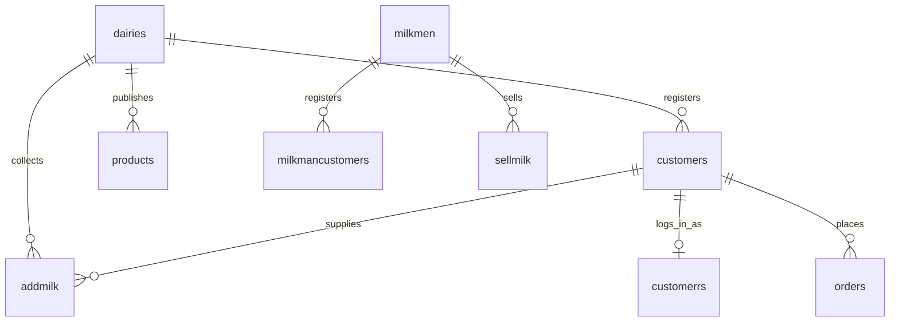

# 🥛 MilkMate — Smart Dairy Ecosystem & Milk Delivery Platform

<p align="center">
  
</p>

<p align="center">
  <strong>A full-stack, unified dairy management and farm-to-doorstep e-commerce platform connecting Dairy Centers, Milkmen Vendors, and Household Customers.</strong>
</p>

<p align="center">
  
  
  
  
  
  
</p>

---

## 📖 Table of Contents

1. [Project Overview](#-project-overview)
2. [Key Problem Solved](#-key-problem-solved)
3. [User Roles & Portals](#-user-roles--portals)
   - [1. Dairy Owner Portal](#1-dairy-owner-portal)
   - [2. Milk Delivery Vendor (Milkman) Portal](#2-milk-delivery-vendor-milkman-portal)
   - [3. Customer & Consumer Portal](#3-customer--consumer-portal)
   - [4. Fresh Dairy Marketplace & E-Commerce](#4-fresh-dairy-marketplace--e-commerce)
4. [Modern UI / UX Highlights](#-modern-ui--ux-highlights)
5. [Tech Stack](#-tech-stack)
6. [Database Architecture & Models](#-database-architecture--models)
7. [Project Directory Structure](#-project-directory-structure)
8. [Installation & Setup](#-installation--setup)
9. [Instant Demo Access](#-instant-demo-access)
10. [API & Routing Reference](#-api--routing-reference)
11. [Suggested Enhancements & Roadmap](#-suggested-enhancements--roadmap)
12. [Project Team & Credits](#-project-team--credits)

---

## 🌟 Project Overview

**MilkMate** is a full-stack web application engineered to modernize and digitize daily operations across the dairy supply chain. Built using **Node.js, Express.js, Firebase Firestore (Cloud NoSQL), Flashpop, and EJS**, it addresses the common friction points in milk collection, rate calculation, farmer ledger maintenance, and doorstep delivery.

Whether it is a cooperative dairy collecting hundreds of liters each morning and evening, an independent milkman managing a morning delivery route across city neighborhoods, or a customer wanting complete transparency into their daily milk passbook and ordering pure dairy products — **MilkMate brings everyone onto a single, real-time platform.**

---

## ⚡ Key Problems Solved

| Traditional Manual Dairy Operations | The MilkMate Solution |
| :--- | :--- |
| **Vulnerable Paper Registers:** Ledgers torn, lost, or damaged in wet dairy environments. | **100% Cloud-Backed Ledgers:** Google Firebase Firestore stores persistent, timestamped records across all collections in real time. |
| **Arithmetic Errors in Fat/Rate Calculations:** Manual multiplication of Liters &times; Rate leads to farmer disputes. | **Automated Fat & SNF Rate Engine:** Standard dairy formula `Rate = (Fat × 6.5) + (SNF × 3.5)` calculates unit rates & totals live on screen. |
| **Backdating & Shift Tampering:** Staff manually backdate collections or misallocate morning/evening deliveries. | **Locked Auto-Date & Auto-Shift:** Real-time clock locks the date to today and auto-determines Morning vs Evening shifts without manual override. |
| **Lack of Farmer Transparency:** Farmers don't know their exact balance until the end of the month. | **Self-Service Digital Passbook:** Customers and farmers log in on their phones to inspect every drop with Fat & SNF transparency. |
| **Delayed & Confusing Payouts:** Cumbersome reconciliations when settling dues or deleting historical entries. | **Complete & Partial Settlement Engine:** Settle 100% or custom partial installments with complete historical ledger preservation, live balance calculation, and audit receipts. |
| **Duplicate Records & Inconsistent Shifts:** Redundant entries, missing evening logs, and duplicate customer entries across centers. | **Dual-Shift Validation & 100% Unique Registries:** Guaranteed Morning & Evening records on every collection date with 100 uniquely verified farmers. |
| **Unsold Surplus Milk:** No direct avenue for dairies to sell processed ghee, paneer, and butter. | **Integrated E-Commerce Store:** Direct farm-to-consumer store with cart, checkout, and payment options. |

---

## 👥 User Roles & Portals

### 1. Dairy Owner Portal
Designed for dairy collection centers, milk chillers, and cooperatives:
- **Unique Dairy Code Identification:** Each dairy operates with a unique code (e.g. `101`).
- **Farmer / Supplier Directory:** Enroll farmers with contact details, customer code, and residential address.
- **Morning & Evening Milk Intake:** Record morning/evening milk collections with quantity (liters) and rate per liter.
- **Consolidated Ledger & Settlement:** Review total milk collected (Liters), total payouts due (₹), and execute single-click settlements.
- **Product Management:** Add, edit, or delete packaged dairy items (Ghee, Butter, Paneer, Curd) in the public storefront.

### 2. Milk Delivery Vendor (Milkman) Portal
Designed for independent milk distributors delivering to residential homes:
- **Route Customer Ledger:** Register delivery households along delivery routes.
- **Delivery Logging:** Log morning or evening drops with quantity, rate, and delivery date.
- **Customer Billing:** Track accumulated delivery bills for each household.
- **Payment Collection & Clearance:** Mark monthly or weekly milk dues as paid with instant balance clearance.

### 3. Customer & Consumer Portal
Designed for households and milk buyers:
- **Digital Milk Passbook:** View an exact, chronological breakdown of every morning and evening delivery.
- **Transparent Statements:** View liters, rates applied, shift badges, daily subtotals, and total pending bill.
- **Profile Management:** Update contact number, name, and residential delivery address.
- **Printable Statements:** 1-Click clean printout of monthly statements for personal verification.

### 4. Fresh Dairy Marketplace & E-Commerce
An integrated storefront accessible to customers and visitors:
- **Catalog Browsing:** Browse farm-fresh dairy items with pricing and freshness tags.
- **Shopping Cart (`/cart`):** Add items, update quantities with stepper controls (`-` / `+`), and calculate totals.
- **Checkout (`/cart/checkout`):** Seamless checkout supporting Cash on Delivery (COD), UPI with simulated VPA, and Credit/Debit Cards.
- **Order Confirmation:** Automated order logging with celebratory success screen.

---

## 🎨 Modern UI / UX Highlights

The user interface has been completely transformed into a modern, aesthetic SaaS-grade experience:
- **Global Design Tokens (`public/css/style.css`):** Cohesive emerald green, sky blue, butter gold, and clean slate color palette with smooth CSS variables.
- **Typography:** Modern Google Fonts pairing (**Plus Jakarta Sans** for headers, **Inter** for readable body copy).
- **Glassmorphic Navigation Bar:** Sticky top navigation with translucent backdrop blur, brand logo, dynamic user role chip (Avatar + Role #Code), active state pills, and responsive mobile drawer.
- **Interactive Landing Page:** High-converting hero section, quick demo access banner, role gateway cards, feature highlights, and workflow steps.
- **Dynamic Login Experience:** Interactive role switcher tabs (Customer / Dairy / Milkman) that dynamically adapt form actions, password visibility toggle eye, and 1-click **"Auto-Fill Demo Credentials"** button.
- **Executive SaaS Dashboards:** Replaced outdated plain layouts with welcoming banner cards, live operational clock, KPI status pills, and interactive 3D action tiles with hover elevation.
- **Interactive Tables & Passbooks:** Rounded borders, avatar initials, search bar with live filtering, morning/evening shift badges, and `@media print` support for instant physical statements.
- **E-Commerce Flow:** Floating cart dock, animated add-to-cart toast alerts, quantity steppers, and simulated multi-method checkout.

---

## 🛠 Tech Stack

### Core Frameworks & Runtime
- **Node.js** (v18+) — High-performance asynchronous JavaScript runtime
- **ES Modules (ESM)** — Native ECMAScript standard (`import` / `export`) throughout the entire codebase
- **Express.js** (v4.21+) — Web application server framework
- **Google Firebase Firestore** — Cloud NoSQL real-time document database (`milkmate-7ee57`)
- **Firebase JS SDK (v12+)** — Modular Web SDK for fast, serverless cloud storage

### Templating & State Management
- **EJS (Embedded JavaScript)** — Server-side templating engine
- **Express-Session** — Session persistence across authenticated requests
- **Flashpop** — Modern interactive flash notification toast system (npm package by Shyam Patidar)
- **Connect-Flash** — Session-backed flash message delivery pipeline
- **Method-Override** — Support for RESTful `PUT` and `DELETE` requests in HTML forms

### Frontend & Styling
- **Custom CSS3 Design System** — CSS Variables, Flexbox, CSS Grid, Glassmorphism
- **Google Fonts** — *Plus Jakarta Sans* & *Inter*
- **Font Awesome 6.5.2** — Vector iconography
- **Flashpop CSS** — Smooth floating alerts with SVG icons and slide-in animations

---

## 🧮 Automatic Fat & SNF Pricing & Locked Shifts

MilkMate features a transparent, automated dairy calculation engine preventing backdating and disputes:

### 1. Dairy Rate Formula
Milk purchase and sale rates are derived using India's standard cooperative Fat & SNF valuation:
$$\text{Rate (₹/Liter)} = (\text{Fat} \times 6.5) + (\text{SNF} \times 3.5)$$
$$\text{Total Amount (₹)} = \text{Liters} \times \text{Rate}$$

- As users adjust Fat (e.g., `4.5%`) and SNF (e.g., `8.5%`), the **Unit Rate** and **Total Payout** update instantly in real time on the screen.
- The same formula is verified and immutably stamped by the backend router upon submission.

### 2. Locked Date & Shift
- **Date Automation:** Pre-populated with current date (`YYYY-MM-DD`) and set to `readonly` / locked. Cannot be manually altered or backdated.
- **Shift Automation:** Intelligently checks the current system clock:
  - `03:00` to `12:59` $\rightarrow$ **Morning Shift (`Mor`)**
  - `13:00` to `02:59` $\rightarrow$ **Evening Shift (`Eve`)**
- Form dropdowns are disabled/read-only on the frontend, and the backend server explicitly enforces `new Date()` and the shift time check before persisting to Firestore.

### 3. Real-Time Farmer & Customer Side-View
- In `/dairy/add` (Milk Intake) and `/milkman/sell` (Doorstep Delivery), entering the customer/farmer code automatically queries the backend and displays a **Live Profile Side Card**:
  - **Farmer Avatar & Full Name** with verified affiliation badges.
  - **Phone Number** with 1-click calling (`tel:`) and residential village address.
  - **Real-Time Delivery Metrics**: Total milk delivered to date (Liters) and current pending payout balance (₹).
  - **Last Transaction Summary**: Most recent delivery date, shift, liters, and rate.
  - Direct 1-click button to view the farmer's complete chronological passbook.
  - If a code does not exist, an alert prompts with an immediate shortcut to enroll the farmer.

### 4. Account Settlement & Clearance Engine (Complete or Partial)
- **Settlement Modes**:
  - **Complete Settlement (100% Clearance)**: Pre-fills and locks payment to the exact net pending balance, marking the account 100% Cleared (Zero Dues).
  - **Partial Settlement (Installment Payment)**: Allows dairy owners to pay any custom amount $\le$ current pending balance, automatically updating the remaining debt.
- **Audit Ledger & Profile Reflection**:
  - Preserves daily milk intake history (records are no longer deleted on payment).
  - **Firestore Collection `settlements`** tracks timestamp, settled amount, payment method (Cash, UPI, Bank Transfer, Cheque), notes, and remaining balance.
  - **Customer Profile (`/customers/:id`)** displays a live Account Status badge, 4-tier KPI metrics (Delivered Liters, Gross Accrued, Already Paid, Net Pending), and an audit table of all historical settlement receipts.
  - **Customer Directory (`/customers/allcustomers`)** displays real-time clearance badges (`Cleared`, `Partial Due`, `Pending`).

---

## 🗄 Database Architecture & Models (Firebase Firestore)

All data is stored in **Google Cloud Firestore** under project `milkmate-7ee57`. MilkMate uses a schema-compatible Firestore adapter (`config/firebaseModel.js`) to provide seamless Mongoose-like ORM queries (`find`, `findOne`, `findById`, `create`, `findByIdAndUpdate`, `findByIdAndDelete`, `deleteMany`).



### Firestore Collections Summary:
1. **`dairies` (`Models/dairy.js`)**: Dairy owner profile (`dairyCode` unique, center name, owner name, contact, password).
2. **`milkmen` (`Models/milkman.js`)**: Milk vendor profile (`milkmanCode` unique, name, contact, route address, email, password).
3. **`customers` (`Models/customer.js`)**: Farmer/customer profiles registered by dairy owner (`code`, `codeD`, first, last, contact, address).
4. **`customerrs` (`Models/customerr.js`)**: Authentication credentials for customers logging into the web portal.
5. **`milkmancustomers` (`Models/milkmancustomer.js`)**: Household delivery customer registered by a milkman.
6. **`addmilk` (`Models/addmilk.js`)**: Dairy intake logs with `dairyCode`, `code`, `date`, `shift`, `fat`, `snf`, `liter`, `rate`, and `amount`.
7. **`sellmilk` (`Models/sellmilk.js`)**: Milkman delivery logs with `milkmanCode`, `code`, `date`, `shift`, `fat`, `snf`, `liter`, `rate`, and `amount`.
8. **`products` (`Models/product.js`)**: Store items (`name`, `price`, `desc`, `image`, `code`).
9. **`orders` (`Models/order.js`)**: E-commerce customer orders with customer info, payment method, items, and total amount.

---

## 📁 Project Directory Structure

```text
Milkmate/
├── .env                     # Environment variables (MONGO_URI, SESSION_SECRET, PORT)
├── .gitignore               # Git ignored directories
├── app.js                   # Application entry point & server bootstrap
├── package.json             # NPM package dependencies and scripts
│
├── Models/                  # Mongoose Schema Models
│   ├── addmilk.js           # Dairy milk intake records
│   ├── customer.js          # Dairy customer profiles
│   ├── customerr.js         # Customer authentication model
│   ├── dairy.js             # Dairy owner schema
│   ├── milkman.js           # Milkman vendor schema
│   ├── milkmancustomer.js   # Milkman route customer schema
│   ├── order.js             # E-commerce customer orders
│   ├── product.js           # Store dairy products
│   └── sellmilk.js          # Milkman delivery logs
│
├── routes/                  # Express Router Endpoints
│   ├── auth.js              # Signup, login, and logout for all 3 roles
│   ├── cart.js              # Shopping cart & checkout payment routes
│   ├── customerrs.js        # Customer passbook & profile routes
│   ├── dairy.js             # Dairy milk intake & settlement routes
│   ├── dairy2.js            # Dairy customer management routes
│   ├── milkman.js           # Milkman deliveries & customer management
│   ├── others.js            # Landing, About, and Contact pages
│   └── product.js           # Product CRUD & marketplace catalog
│
├── middleware/              # Route Protection Middlewares
│   └── auth.js              # isLoggedIn session check
│
├── utils/                   # External Service Utilities
│   └── sendSMS.js           # SMS notification helper
│
├── public/                  # Static Assets
│   ├── images/              # Team photos & avatars
│   └── css/                 # Modern Stylesheets
│       ├── style.css        # Global design tokens & CSS variables
│       ├── includes/        # Navbar & Footer CSS
│       ├── user/            # Landing, Login, and Signup CSS
│       ├── dairy/           # Dairy dashboard, tables, and product CSS
│       ├── milkman/         # Milkman dashboard CSS
│       ├── customers/       # Customer dashboard CSS
│       ├── milk/            # Milk intake & delivery form CSS
│       ├── product/         # Cart, checkout, and payment CSS
│       └── others/          # About and Contact page CSS
│
└── views/                   # EJS Templates
    ├── includes/            # navbar.ejs, footer.ejs, flash.ejs
    ├── user/                # front.ejs, login.ejs, main.ejs, dairy.ejs, milkman.ejs, customer.ejs
    ├── dairy/               # front.ejs, index.ejs, show.ejs, add.ejs, edit.ejs
    ├── milkman/             # front.ejs, index.ejs, show.ejs, add.ejs, edit.ejs, details.ejs
    ├── customer/            # front.ejs, show.ejs, edit.ejs
    ├── milk/                # add.ejs, sell.ejs, details.ejs
    ├── product/             # product.ejs, addproduct.ejs, edit.ejs, cart.ejs, checkout.ejs, pay.ejs
    └── others/              # about.ejs, contact.ejs
```

---

## 🚀 Installation & Setup

### 1. Prerequisites
- [Node.js](https://nodejs.org/) (Version 18.x or later installed)
- Firebase Cloud project credentials (already preconfigured in `config/firebase.js`)

### 2. Clone / Open Repository
```bash
cd "C:\Users\Shyam17\Desktop\PROJECTS\Milkmate"
```

### 3. Install Dependencies
```bash
npm install
```

### 4. Configure Environment Variables (Optional)
Create or verify your `.env` file in the project root:
```env
SESSION_SECRET=milkmate_super_secret_session_key
PORT=8080
```

### 5. Seed Demo Data to Firestore (Optional / One-time)
```bash
node config/seedFirebase.js
```

### 6. Launch Application
```bash
node app.js
```
The console will display:
```text
🔥 Initialized Firebase App: milkmate-7ee57
🔥 Connected to Firestore (Database: milkmate-7ee57)
🚀 MilkMate Server running at http://localhost:8080
```
Open **`http://localhost:8080`** in any web browser.

---

## 🔑 Instant Demo Access & Pre-Seeded Ecosystem

MilkMate includes a pre-seeded, enterprise-grade dairy ecosystem with **5 Dairies**, **10 Milkmen**, and **100 Completely UNIQUE Customers (20 Distinct Farmers per Dairy + Demo Customer 101)** along with **5,850+ milk intake records spanning the past 3 months (with BOTH Morning & Evening shifts on every collection date)**:

### Quick 1-Click Demo Login:
| Field | Quick Demo Credentials |
| :--- | :--- |
| **User Roles** | Customer / Dairy / Milkman |
| **Dairy Code / Mobile** | Dairy: `101` \| Customer: `9879638521` (Code `101`) \| Milkman: `101` |
| **Password** | `password123` |

> 💡 **Tip:** On the `/login` page, simply click the role tab and use the pre-seeded credentials or quick autofill for immediate access!

### 5 Pre-Seeded Dairies & 100% Unique Farmer Registries:
Every dairy is situated in a major dairy agricultural corridor and features **20 completely unique, regionally authentic farmers with zero duplicates in names, phone numbers, or addresses**:

| Dairy Code | Dairy Center Name | Region / Hub | Sample Unique Enrolled Farmers | Total Records |
| :---: | :--- | :--- | :--- | :---: |
| **101** | Saras Milk Dairy Cooperative | Indore / Malwa, MP | Ramkaran Patidar, Devilal Malviya, Bherulal Choudhary, Mangilal Parmar, Shivnarayan Dangi... (+ Demo 101) | 1,218 records (Both Shifts) |
| **102** | Amul Sangam Chilling Center | Anand, Gujarat | Arvindbhai Patel, Bhaveshbhai Desai, Chimanbhai Rabari, Dharmeshbhai Bharwad, Ganeshbhai Gohil... | 1,160 records (Both Shifts) |
| **103** | Krishna Dairy Farm & Chiller | Mathura / Braj, UP | Shyam Bihari Yadav, Radhey Shyam Gurjar, Brijesh Sharma, Balram Goswami, Murari Lal Baghel... | 1,160 records (Both Shifts) |
| **104** | Radhe Govind Dudh Utpadan | Jaipur, Rajasthan | Bhanwar Singh Shekhawat, Tejaram Jat, Moolchand Meena, Sheoram Kumawat, Hanuman Prasad Tanwar... | 1,160 records (Both Shifts) |
| **105** | Ganga Godavari Milk Federation | Nashik, Maharashtra | Dnyaneshwar Shinde, Tukaram Deshmukh, Pandurang Patil, Eknath Gawali, Namdeo Jadhav... | 1,160 records (Both Shifts) |

### 🌅 Dual-Shift Milk Ingestion (Morning & Evening Every Single Day):
- Every single collection date across August, September, and October contains **BOTH SHIFTS**:
  - **Morning Shift (`Mor`)**: Higher initial volume, baseline fat (3.8% – 7.6%), SNF (8.2% – 9.4%).
  - **Evening Shift (`Eve`)**: Natural evening fat bonus (+0.2% – +0.5%), adjusted milking volume (4.0L – 20.0L).
- **Zero Duplicate Details**: Every farmer's milk metrics vary realistically according to breed profile, weather fluctuation, and seasonal temperature.
- **Strict Mathematical Accuracy**: Unit rates and totals are calculated strictly using `Rate = (Fat × 6.5) + (SNF × 3.5)` and `Amount = Liters × Rate`.

### 💳 Complete vs. Partial Settlement System:
- **Historical Ledger Preservation**: Settling an account no longer deletes historical milk intake entries. All 5,850+ records remain permanently recorded for audits.
- **Settlement Mode Toggle**: Switch between **Complete Settlement (100% Full Clearance)** and **Partial Settlement (Custom Installment)** directly from the farmer's passbook.
- **Latest-Date-First Ledger Display**: Milk collection and delivery tables across all portals are sorted **latest date first** (newest deliveries on top; Evening shift preceding Morning shift on matching dates).
- **Green Row Highlight for Paid Records**: Any record whose payment is completed (or covered by cumulative settlement payouts) is dynamically highlighted with a **soft emerald green background** (`#ecfdf5`) and marked with a verified **Paid** badge (`<span class="payment-badge payment-paid">Paid</span>`). Unsettled records are displayed in standard neutral styling with a **Pending** badge.
- **Live Receipt Preview**: Automatically calculates remaining pending balance in real time before submitting.
- **Chronological Settlement Ledger**: Detailed audit table displaying settlement date, amount paid, payment mode (Cash, UPI, NEFT, Cheque), notes, and approving manager name.
- **Clearance Status Badges**: Direct visibility in the Dairy Customer Directory (`100% Cleared`, `Partial Due`, `Pending`).

---

## 📡 API & Routing Reference

### Authentication & Public Pages
| Route | Method | Access | Description |
| :--- | :---: | :---: | :--- |
| `/` | `GET` | Public | Modern landing page |
| `/login` | `GET` | Public | Role-based login screen |
| `/login/:type` | `POST` | Public | Process login (`customer`, `dairy`, `milkman`) |
| `/signup` | `GET` | Public | Role selection screen |
| `/signup/dairy` | `GET / POST` | Public | Dairy center registration |
| `/signup/milkman`| `GET / POST` | Public | Milkman vendor registration |
| `/signup/customer`| `GET / POST` | Public | Customer portal activation |
| `/logout` | `GET` | Private | Destroy session and redirect to `/` |
| `/about` | `GET` | Public | About Us & mission story |
| `/contact` | `GET` | Public | Support channels & developer team |

### Dairy Center Operations
| Route | Method | Description |
| :--- | :---: | :--- |
| `/dairy` | `GET` | Dairy control dashboard |
| `/dairy/add` | `GET / POST` | Log morning/evening milk intake |
| `/dairy/details` | `GET` | Complete dairy collection ledger & payout stats |
| `/dairy/pay` | `POST` | Settle and clear customer milk dues |
| `/dairy/delete` | `POST` | Clear all dairy ledger records |
| `/customers/allcustomers` | `GET` | All enrolled dairy customers with search |
| `/customers/add` | `GET / POST` | Enroll new farmer under dairy |
| `/customers/:id` | `GET` | View individual farmer passbook & history |
| `/customers/:id/edit` | `GET / PUT` | Edit customer profile |
| `/customers/:id` | `DELETE` | Remove customer from dairy directory |

### Milkman Distribution Operations
| Route | Method | Description |
| :--- | :---: | :--- |
| `/milkman` | `GET` | Milkman vendor dashboard |
| `/milkman/sell` | `GET / POST` | Record doorstep milk delivery |
| `/milkman/allcustomers` | `GET` | View all route delivery households |
| `/milkman/add` | `GET / POST` | Add new household customer to route |
| `/milkman/details` | `GET` | Sales history & total earnings summary |
| `/milkman/pay` | `POST` | Mark customer bill as received/paid |
| `/milkman/:id` | `GET` | View household delivery passbook |
| `/milkman/:id/edit` | `GET / PUT` | Edit household customer details |
| `/milkman/:id` | `DELETE` | Remove household customer |

### Customer & Store Operations
| Route | Method | Description |
| :--- | :---: | :--- |
| `/customerrs` | `GET` | Customer profile dashboard |
| `/customerrs/details` | `GET` | Digital milk passbook & delivery ledger |
| `/product/all` | `GET` | Public farm-fresh dairy marketplace |
| `/product` | `GET` | Vendor product management (Add/Edit/Delete) |
| `/product/add` | `GET / POST` | Add new product to store |
| `/product/edit/:id` | `GET / PUT` | Update product details |
| `/product/delete/:id` | `DELETE` | Remove product from store |
| `/cart` | `GET` | View active shopping cart |
| `/cart/add` | `POST` | AJAX endpoint to add product to cart |
| `/cart/update/:id` | `POST` | Increase or decrease cart quantity |
| `/cart/delete/:id` | `DELETE` | Remove item from cart |
| `/cart/checkout` | `GET` | Checkout page with billing details |
| `/cart/pay` | `POST` | Place order (COD, UPI, Card) |

---

## 🔮 Suggested Enhancements & Roadmap

### 1. Security & Authentication
- **Password Hashing with Bcrypt:** Currently some plain-text passwords exist in legacy models; hash all passwords using `bcrypt.hash(password, 12)` on pre-save hooks.
- **Role-Based Access Control (RBAC):** Restrict `/dairy` routes exclusively to `user.type === 'dairy'` and `/milkman` exclusively to `user.type === 'milkman'` using role middleware.
- **JWT / Two-Factor Authentication:** Implement OTP verification over WhatsApp or SMS on login for rural farmers.

### 2. Business Logic & Feature Additions
- **Automated Fat / SNF Rate Chart Calculator:** Allow dairy owners to define a dynamic Fat/SNF grid (e.g. ₹6.50 per 0.1% Fat) so entering Fat & SNF automatically sets the rate per liter.
- **Downloadable PDF Receipts & Invoices:** Integrate `pdfkit` or `html-pdf` to generate downloadable monthly milk slips with barcode/QR code.
- **SMS & WhatsApp Delivery Notifications:** Trigger automated WhatsApp/SMS alerts via Twilio whenever morning/evening milk is logged or settled.
- **Payment Gateway Integration:** Upgrade the simulated checkout with real Indian payment gateways like **Razorpay** (supporting PhonePe, Google Pay, Paytm, NetBanking).

### 3. Analytics & Visualization
- **Interactive Shift Analytics (Chart.js):** Add interactive graphs on the Dairy and Milkman dashboards showing daily liters collected over the last 30 days and revenue trends.
- **Milk Quality Grading:** Track Buffalo vs. Cow milk categories with separate Fat/SNF benchmarks.

### 4. Progressive Web App (PWA) & Offline Mode
- Add a Service Worker and Web App Manifest (`manifest.json`) so milkmen can install MilkMate onto their Android/iOS homescreens as a native-feeling app and log deliveries even with patchy village internet.

---

## 👨‍💻 Project Team & Credits

| Team Member | Role | LinkedIn |
| :--- | :--- | :--- |
| **Shyam Patidar** | Full-Stack Developer | [LinkedIn Profile](https://www.linkedin.com/in/shyam-patidar-736b77257) |
| **Aashish Sencha** | Full-Stack Developer | [LinkedIn Profile](http://www.linkedin.com/in/aashish-sencha-5855bb228) |
| **Aditi Sharma** | UI/UX Designer | [LinkedIn Profile](https://www.linkedin.com/in/aditi-sharma-49839b2b5) |
| **Dhruv Gour** | Full-Stack Developer | [LinkedIn Profile](https://www.linkedin.com/in/dhruv-gour-a82809258) |

---

<p align="center">
  Made with ❤️ for Indian Dairy Farmers, Milk Vendors, and Modern Cooperatives.<br>
  <strong>&copy; 2026 MILKMATE. All rights reserved.</strong>
</p>
